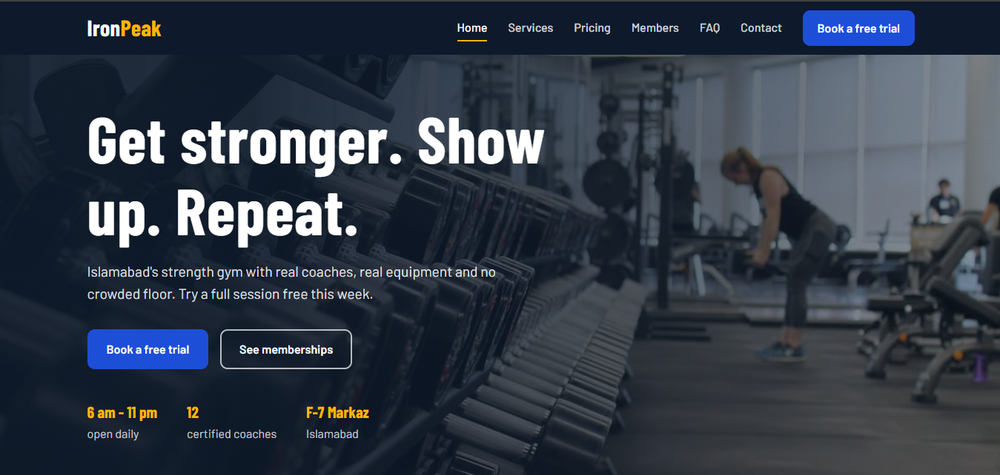
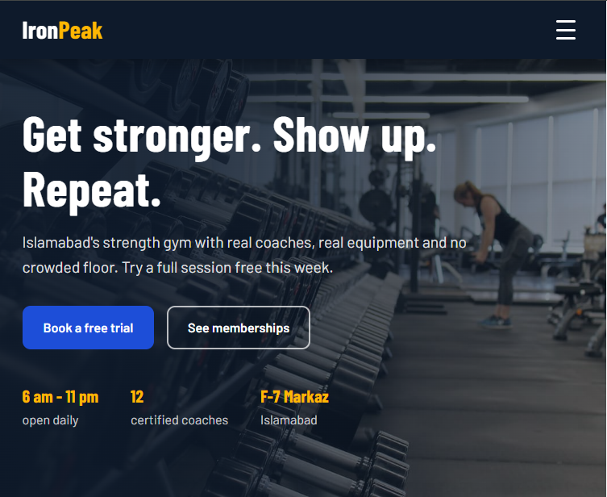
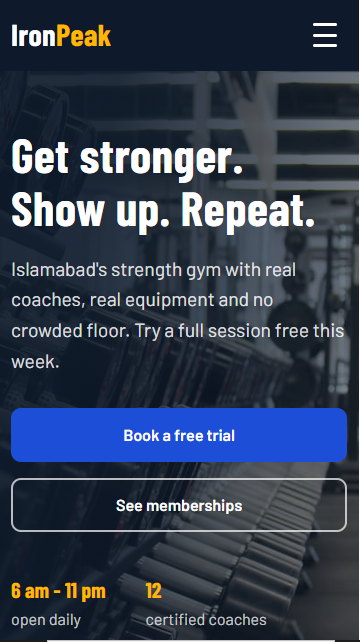
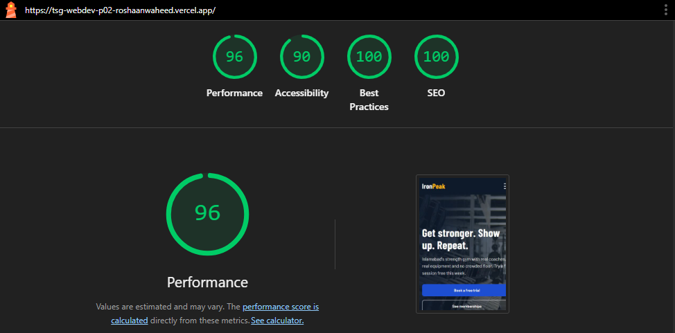

# IronPeak Fitness - Responsive Business Landing Page

- **Live site:** https://tsg-webdev-p02-roshaanwaheed.vercel.app/ 
- **Repository:** https://github.com/RoshaanWaheed/TSG-webdev-P02-roshaanwaheed 

## Business concept

IronPeak Fitness is a fictional strength-focused gym in F-7 Markaz, Islamabad. It targets young professionals and students who want proper coaching without a crowded floor. The page has one goal: get visitors to book a free trial session. The flow is hero, services, pricing, social proof, FAQ, then a contact form, so each section removes one doubt before the call to action.

## Features

- Sticky navigation with smooth scrolling and active-link highlight (IntersectionObserver)
- Hero section with background image, headline, sub-headline and call-to-action buttons
- Services section with six cards, icons and hover effects
- Pricing table with three plans and a highlighted recommended plan
- Testimonials slider with arrows, dots, swipe support and wrap-around
- FAQ accordion with six questions (one open at a time, keyboard accessible)
- Contact form with client-side validation and an embedded Google Map
- Footer with business info, quick links and social icons
- Fully responsive at three breakpoints with a working hamburger menu

## Tech stack

- HTML5
- CSS3 (custom properties, flexbox, media queries)
- Bootstrap 5.3 (CSS and grid only, no Bootstrap JavaScript)
- Vanilla JavaScript (menu, slider, accordion, form validation)
- Git and GitHub
- Vercel (hosting)
- Google Maps Embed
- Chrome DevTools and Lighthouse

## Folder structure

```
tsg-webdev-p02-roshaanwaheed/
  css/
    style.css
  docs/
    Desktop.PNG
    Lighthouse_Performance.PNG
    Mobile.PNG
    Tablet.PNG
  images/
    pic.jpg
  js/
    main.js
  index.html
  README.md
```

## Responsive screenshots

| Breakpoint | Screenshot |
|---|---|
| Desktop (1440px) |  |
| Tablet (768px) |  |
| Mobile (375px) |  |

## Lighthouse report



## Deliverables 
 
 https://drive.google.com/file/d/1z85S3ELiFiBSY2SepYwd1hEejZOCXA-R/view?usp=sharing


## Breakpoints

- 992px and below: navigation collapses into the hamburger menu
- 768px and below: tablet and large phone spacing
- 480px and below: small phone layout, full-width buttons

## Credits

- Hero photo: Unsplash 
- Icons: Bootstrap Icons
- Fonts: Barlow and Barlow Condensed via Google Fonts (SIL Open Font License)
- CSS framework: Bootstrap 5 
- Business name, copy, testimonials and prices are fictional.
